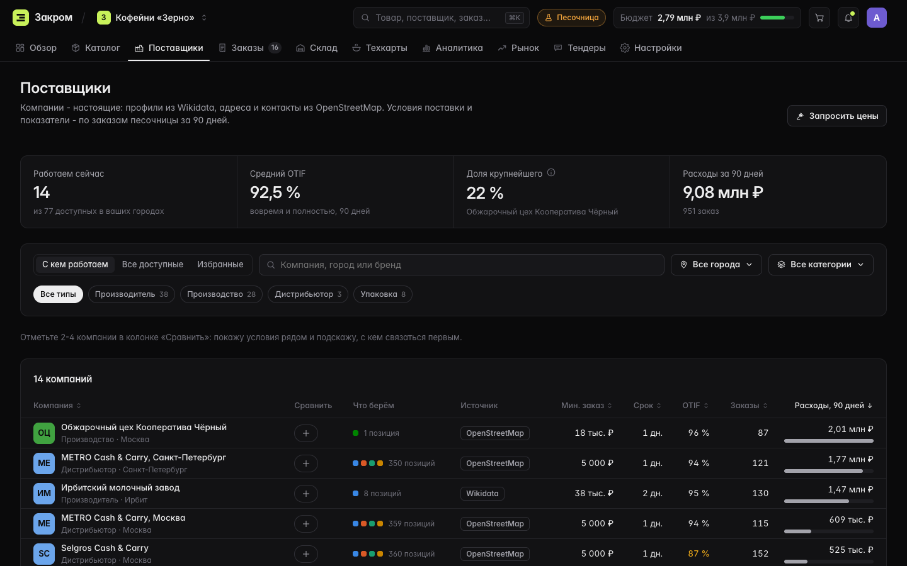
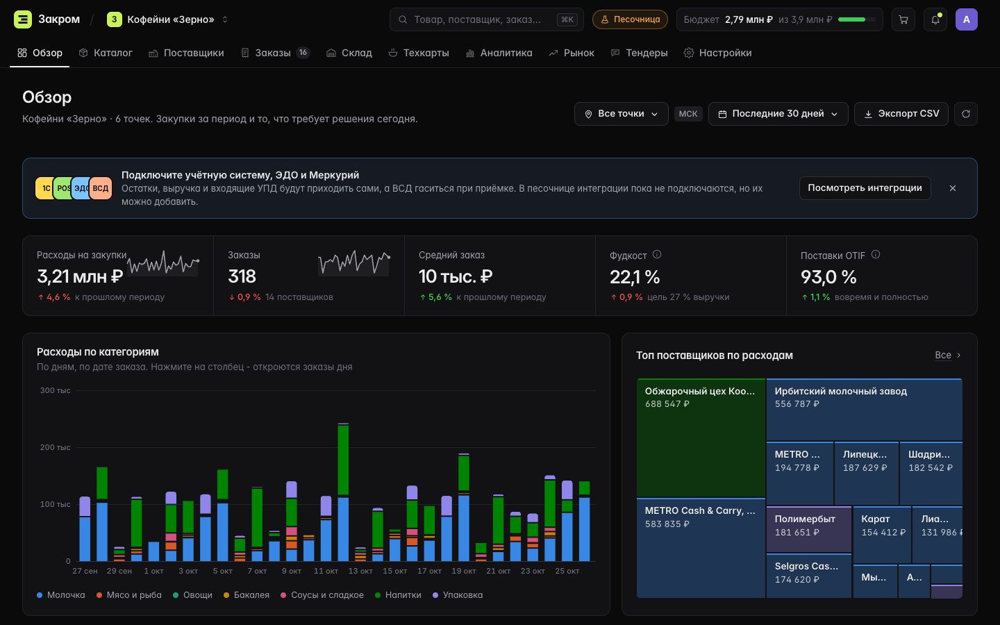
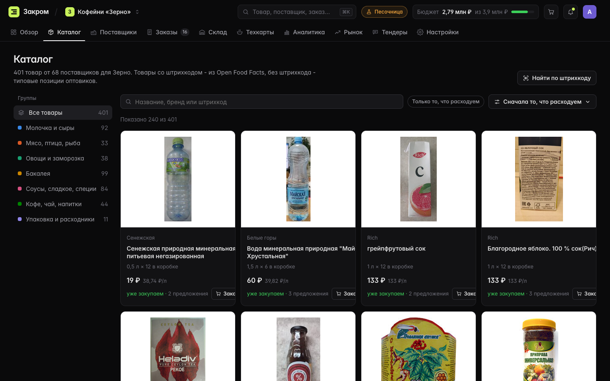
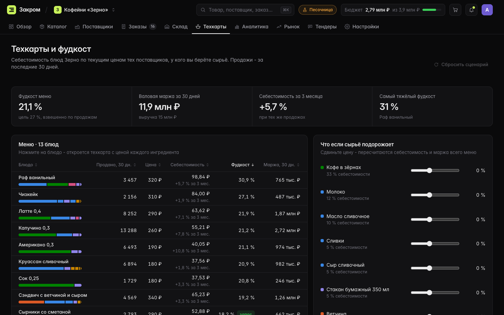

# Закром

**Сервис для поиска и сравнения поставщиков продуктов питания:** сырья, готовой продукции и упаковки. Помогает найти поставщика в нужном городе, собрать по нему всё важное на одной странице и решить, кому писать первым.

**Прототип:** https://goshkow.github.io/zakrom/ · открывается в браузере, без регистрации и установки



## Идея

Закупщик кофейни или пищевого производства ищет поставщиков в поисковике, по рекомендациям и в старых таблицах. Контакты, минимальный заказ, сроки и документы раскиданы по сайтам и переписке, а сравнивать их приходится вручную.

Закром собирает это в один кабинет:

1. **Найти.** Фильтры по категории товара, городу и типу компании. Плюс поиск по товару и штрихкоду.
2. **Разобраться.** У каждого поставщика есть профиль: описание, ассортимент, контакты, сайт и ссылка на источник данных.
3. **Решить.** Отметить 2-4 компании и открыть сравнение. Условия встают рядом, а сверху появляется подсказка, кому писать первым, и почему.

Дальше там же можно сделать то, что идёт после выбора поставщика: заказ, приёмку, склад, техкарты и тендер. Так видно, как поиск встраивается в реальную работу закупщика.

## Как проверить за 5 минут

| Шаг | Где | Что увидите |
|---|---|---|
| 1 | **Поставщики** → «Все доступные», город и категория | Список сужается до компаний, которые работают в этом городе и возят нужный товар |
| 2 | Открыть любую компанию | Профиль: контакты, сайт, источник (Wikidata или OpenStreetMap), проверка в ФНС, минимальный заказ, доставка, документы, заметки |
| 3 | Отметить 2-4 компании → **«Сравнение»** | Условия в одной таблице, лучшее значение выделено, сверху подсказка, кому писать первым |
| 4 | **Каталог** → найти товар | Предложения разных поставщиков с ценой и график цены за 12 месяцев |
| 5 | **Тендеры** → «Запросить цены» | Ответы приходят через пару минут, сравнение идёт по полной стоимости с учётом отсрочки |

В шапке можно переключиться между тремя организациями песочницы: сеть кофеен, сеть бургерных и хлебозавод. У каждой своё меню, свои поставщики и своя история закупок.

## Соответствие заданию

| В задании | Где в Закроме |
|---|---|
| Поиск по категории товара | Поставщики → «Все категории», Каталог → поиск по товару и штрихкоду |
| Город или регион | Поставщики → «Все города». У каждого поставщика указан охват: город с областью или вся Россия |
| Основная информация | Профиль: описание, год основания, тип компании, ассортимент |
| Контакты, сайт, источник | Сайт, телефон, почта, ссылка на запись в Wikidata или OpenStreetMap, проверка в «Прозрачном бизнесе» ФНС. Если контакта нет в открытых данных, так и написано |
| С кем связаться | Сравнение 2-4 компаний и подсказка «писать первым» с причинами |
| Минимальный объём заказа | Профиль, таблица поставщиков, сравнение |
| Примерная цена | Каталог: предложения поставщиков и динамика цены |
| Документы и сертификаты | Профиль и сравнение |
| Условия доставки, регион работы | Срок, дни доставки, охват |
| Комментарии и заметки | Поле «Заметки» в профиле. Заметки видны и в сравнении |

### Как считается «писать первым»

Подсказка складывается из шести критериев с весами:

| Критерий | Вес |
|---|---|
| Надёжность поставок (OTIF: вовремя и полностью) | 35% |
| Срок доставки | 20% |
| Минимальный заказ | 15% |
| Отсрочка платежа | 15% |
| Документы и сертификаты | 10% |
| Работает в нужном городе | 5% |

Каждый показатель пересчитывается в шкалу от 0 (худший среди выбранных) до 1 (лучший), затем значения складываются с весами. Рядом с победителем написаны две его самые сильные стороны, например «надёжность поставок, быстрая доставка». Веса показаны под таблицей, формула лежит в [`js/model/compare.js`](js/model/compare.js). Подсказка не решает за человека: она показывает, с кого начать разговор.

## Что настоящее, а что смоделировано

Компании и товары настоящие. Условия поставки и история заказов смоделированы: прайсы и договоры поставщиков не публикуются в открытом доступе. В интерфейсе это видно: в шапке стоит метка «Песочница», а смоделированные блоки в профиле помечены.

| Данные | Источник | Настоящие? |
|---|---|---|
| 361 товар: штрихкод, фото, бренд, фасовка | [Open Food Facts](https://world.openfoodfacts.org) | да |
| 97 компаний: сайт, город, адрес, телефон, год основания | [Wikidata](https://www.wikidata.org), [OpenStreetMap](https://www.openstreetmap.org) | да |
| Курсы USD, EUR и CNY за год | Банк России | да |
| Цены 13 видов сырья за 5 лет: пшеница, сахар, кофе, масло и другие | Всемирный банк (Pink Sheet) | да |
| Минимальный заказ, доставка, отсрочка, документы, OTIF | модель | нет |
| Цены поставщиков и история заказов | модель | нет |

Цены в модели не случайные. Оптовая цена идёт за биржевой ценой сырья, переведённой в рубли по курсу ЦБ, с лагом в месяц. Поэтому мука дорожает вслед за пшеницей, а кофе вслед за арабикой.

## Что ещё умеет



- **Заказы** проходят путь согласование → подтверждение → в пути → приёмка → оплата.
- **Приёмка и сверка.** Заказ, приёмка и УПД сверяются между собой. При недовозе Закром собирает текст претензии.
- **Склад.** Остаток в днях и автозаказ до следующей поставки.
- **Техкарты.** Себестоимость блюд по текущим ценам, фудкост и ползунки «что если сырьё подорожает».
- **Тендеры.** Запрос цен у нескольких поставщиков и сравнение по полной стоимости.
- **Аналитика и рынок.** Расходы по категориям, индекс цены корзины, курсы и биржевые цены.
- Поиск по ⌘K, светлая и тёмная тема, вёрстка под телефон.

| Каталог | Техкарты |
|---|---|
|  |  |

## Почему такой формат

Это **статический веб-прототип**: HTML, CSS и модули JavaScript без сборщика, фреймворков и библиотек. Графики нарисованы на SVG вручную.

- **Открывается по ссылке.** Проверяющему не нужно ничего ставить, заводить аккаунт или ждать холодный старт сервера.
- **Настоящие данные без бэкенда.** Открытые источники заранее скачиваются в JSON скриптами из `tools/`. Прототип не зависит от чужих API в момент показа.
- **Логика проверяется тестами.** Сравнение, модель цен и генератор истории - чистые функции, их покрывают тесты.
- **Полный путь закупки.** Кроме карточек поставщиков видно, как поиск встраивается в ежедневную работу: заказы, склад, расходы.

Всё, что делает пользователь (заметки, заказы, избранное), хранится в `localStorage` и сбрасывается в настройках.

## Как устроено

```
data/sources/*.json   снимки открытых данных (качает tools/fetch_sources.py)
data/catalog.json     товары и поставщики (собирает tools/build-catalog.mjs)
data/market.json      курсы и биржевые цены
js/model/             модель: сырьё, организации, рынок, предложения, история, сравнение
js/app/               состояние, роутинг, шапка, панели, поиск
js/pages/             разделы кабинета
js/ui/                компоненты и графики
tests/                тесты JavaScript (node --test) и Python (unittest)
```

История заказов не хранится, а считается при открытии по цепочке: спрос по меню → расход сырья по техкартам → остатки → заказы с учётом минимального заказа, доставки, опозданий и недовозов. Генератор детерминированный: на одну дату история всегда одинаковая, каждый день добавляется один новый. Для сети кофеен это около 3 000 заказов за 120 мс.

## Путь к боевой версии

1. **Бэкенд и общая база.** Вход, команда и права проверяются на сервере. Модель заказа остаётся той же.
2. **Данные от самих поставщиков.** Загрузка прайса (Excel или CSV), сертификатов и условий через кабинет поставщика. Своя карточка для каждой точки поставки.
3. **Проверка контрагента.** Выписка ЕГРЮЛ и признаки риска через платный API. Бесплатный API выписок ФНС закрыт, поэтому сейчас стоит ссылка на «Прозрачный бизнес».
4. **Интеграции.** 1С, iiko, ЭДО, Меркурий и Честный знак. В настройках они описаны, но пока не работают.
5. **Отзывы и рейтинг.** OTIF и претензии по реальным приёмкам вместо модели.

## Запуск

```bash
python3 -m http.server 8768 --bind 127.0.0.1
```

Затем откройте http://127.0.0.1:8768/. Через `file://` модули не загрузятся.

## Тесты

```bash
npm test
```

Команда запускает проверку импортов, 61 тест на JavaScript и 9 на Python. Тесты покрывают разбор данных, сборку каталога, модель рынка, генератор истории, сравнение поставщиков, сценарии пользователя, аналитику, CSV и штрихкоды.

## Обновить данные

```bash
python3 tools/fetch_sources.py
```

```bash
node tools/build-catalog.mjs
```

Первый скрипт по одному запросу с паузами обращается к бесплатным открытым сервисам, поэтому работает несколько минут. Если сервис упал посередине, при повторном запуске скрипт докачает недостающее.

## Ограничения

- Нет сервера, входа и общей базы. Правила согласования в браузере - удобство, а не защита.
- Нет реальных цен и сертификатов поставщиков: в открытых источниках их нет.
- Проверено в Chrome на ширине 375, 1024 и 1440 px. Safari и Firefox не проверялись.

## Лицензии данных

Open Food Facts - ODbL, фото CC BY-SA. OpenStreetMap - ODbL, © участники OpenStreetMap. Wikidata - CC0. Всемирный банк - CC BY 4.0. Атрибуция есть в подвале каждой страницы. Шрифт Inter - SIL OFL (`assets/fonts/OFL.txt`).

Автор: Иван Агошков · [cv.goshkow.com](https://cv.goshkow.com/) · [t.me/goshkow](https://t.me/goshkow)
